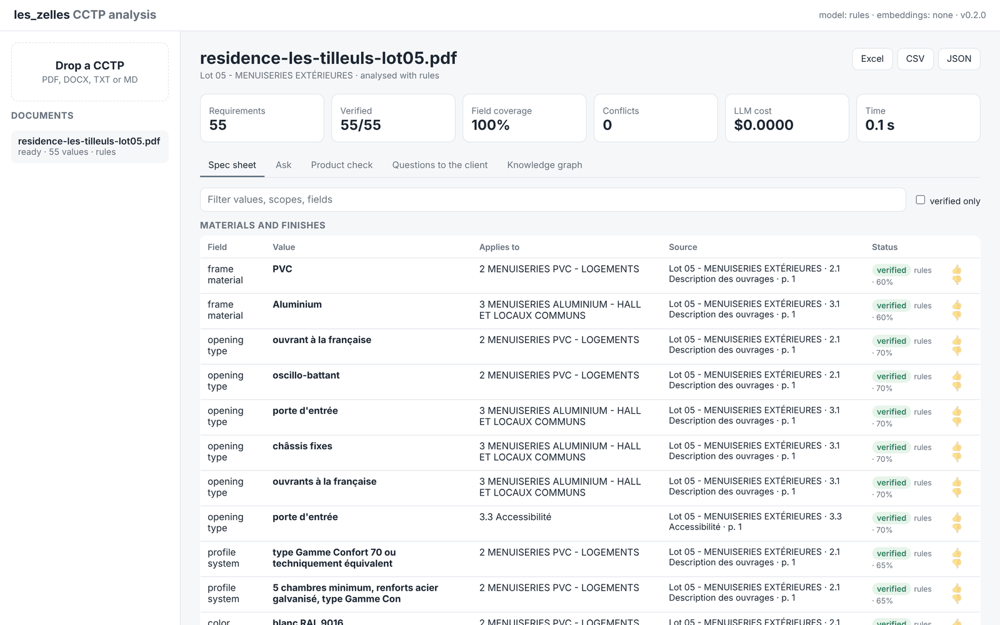
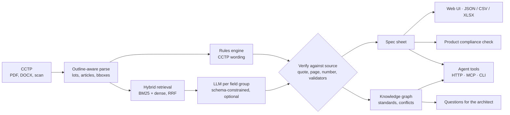
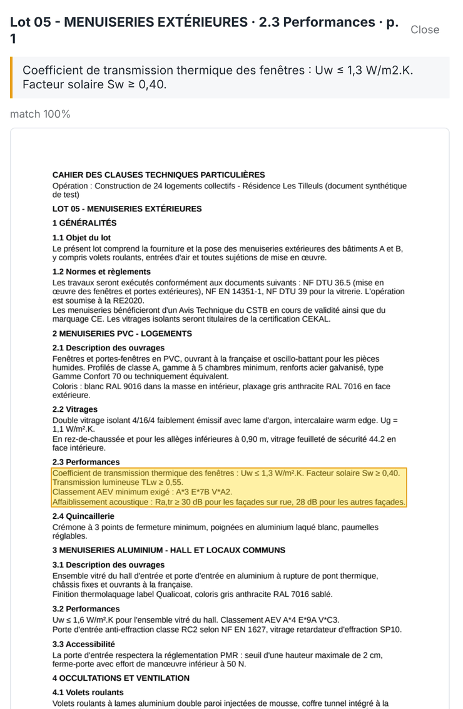
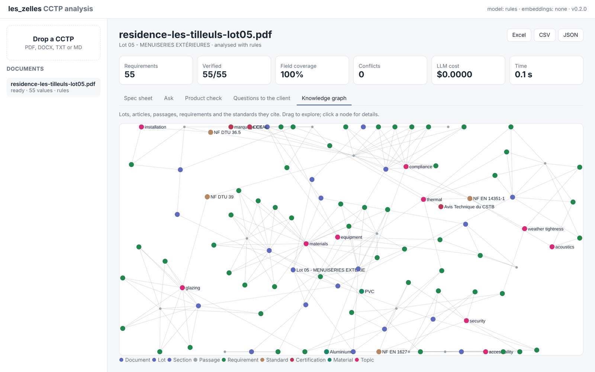

# les_zelles

[](https://github.com/ademasles/les_zelles/actions/workflows/ci.yml)

[](https://docs.astral.sh/uv/)
[](https://docs.astral.sh/ruff/)


**Turn a French joinery tender spec (CCTP) into a cited, verified spec sheet in seconds, with a local model or none at all.**



A joinery contractor answering a public tender (PVC, aluminium or wood windows, doors, curtain walls, shutters) receives a *DCE* with a 40 to 200 page *CCTP*. Before pricing, an estimator has to find every requirement that changes the cost or the product choice: frame material, Uw, glazing build-up, AEV class, acoustic Ra,tr, colours, security class, shutters, installation method, and the standards to comply with. Today that is a manual read, line by line, with a highlighter. Missing one line (an RC2 class on the ground floor, a 36 dB façade) means a wrong quote or a non-compliant delivery.

les_zelles does that read and **shows its work**: every value comes with the exact quote, the page and a highlight on the page image. A value that cannot be found in the source is flagged, never silently kept.

## Results on real tenders

Measured on **9 real joinery CCTPs** (16 to 73 pages each) from public tenders, against hand-checked answer keys. Six are used for development; three are **held out** and their misses are never inspected while tuning.

| Configuration | Held-out F1 | Held-out precision | Dev F1 | Cost per CCTP |
|---|---|---|---|---|
| Rules only (default) | **0.860** | **0.871** | 0.973 | $0 |
| Rules + local LLM (granite4.2 8B, Ollama) | 0.847 | about 4 pts lower | | $0, 2 to 3 min on an 8 GB GPU |
| Rules only, before tuning on the nine tenders | 0.648 | | 0.716 | $0 |

What the numbers say:

- The deterministic engine generalises: held-out F1 went from 0.648 to 0.860 by fixing patterns found on the dev set only.
- A small local model finds a few extra requirements but adds more false positives than it saves, so it is opt-in, not the default. Model choice is a measured decision, not a hope.
- The tender documents are confidential, so they and their answer keys stay out of this repository. A public synthetic case runs in CI as a quality gate. Details in [docs/evaluation.md](docs/evaluation.md).

## How it works



<table>
<tr>
<td width="45%"></td>
<td>

**Every value is grounded.** Click a requirement and the viewer opens the page with the source passage highlighted. Model output is schema-constrained, each quote is located in the document (exact, then fuzzy match), every number must appear in its quote, and domain validators check ranges and formats (Uw, Ug, Sw, AEV classes per EN 12207/12208/12210, RAL codes).

**The graph catches what a reader misses.** Document → Lot → Section → Passage → Requirement, linked to Standards, Certifications, Materials and Topics, with article cross-references and conflict detection when the same scope gets two values.



</td>
</tr>
</table>

## Features

- **Cited spec sheet.** 25 joinery fields in 10 categories, each requirement with value, unit, comparator (`≤ 1.3 W/m².K`), scope (lot, building, room type), confidence and a verified quote.
- **Works without an LLM.** A rules engine written for CCTP wording extracts the common fields for free and deterministically. A model is optional, for the long tail.
- **Local first, cloud optional.** Ollama, llama.cpp, vLLM and LM Studio through one OpenAI-compatible adapter; Anthropic Claude through the official SDK with prompt caching; OpenAI, Mistral, Gemini and OpenRouter as presets. Cost is tracked per document.
- **Decision support.** Check a manufacturer's product against the CCTP (pass, fail or review per requirement) and draft the clarification questions to send to the architect before pricing.
- **Agent harness.** Ten typed tools (search, read passage, requirements, graph walk, conflicts, product check, clarifications...) exposed identically to the built-in agent loop, the HTTP API and an **MCP server**, so Claude Desktop, an IDE or another agent can work on the tenders.
- **Measured.** The evaluation harness reports per-field precision, recall, F1, grounding rate and cost, and fails CI below a threshold.

## Engineering

- **Typed, tested, linted.** `mypy --strict` on the whole package, Ruff, 105 tests (82% coverage) with no network access, a rules-only eval gate and a Docker build in CI on Python 3.12 and 3.13.
- **Modular monolith.** One package, one process, no queue or vector database to operate. Each stage is a typed function or class, so Postgres, a worker pool or Neo4j can replace a component without touching the business logic ([architecture](docs/architecture.md)).
- **No LLM framework.** The `LLM` protocol is three methods; structured output, retries, JSON repair and cost accounting are explicit and tested per provider ([models and cost](docs/models.md)).
- **Production basics.** FastAPI with background jobs and SSE progress, SQLAlchemy 2 with Alembic migrations, content-addressed document ids, optional API key, structured logs.

## Quickstart

Requires Python 3.12+ and [uv](https://docs.astral.sh/uv/).

```bash
git clone https://github.com/ademasles/les_zelles && cd les_zelles
uv sync --extra ocr

# 1. Rules only: free, offline, deterministic
uv run zelles analyze path/to/cctp.pdf -o sheet.xlsx

# 2. With a local model (https://ollama.com)
ollama pull qwen3:8b && ollama pull bge-m3
uv run zelles analyze path/to/cctp.pdf -m ollama:qwen3:8b -e ollama:bge-m3 --save

# 3. With Claude
uv sync --extra anthropic
export ZELLES_LLM_API_KEY=sk-ant-...
uv run zelles analyze path/to/cctp.pdf -m anthropic:claude-sonnet-5-5 --save

# Web UI and API on http://127.0.0.1:8000
uv run zelles serve
```

No CCTP at hand? `evals/golden/residence_tilleuls/cctp.md` is a synthetic one you can upload.

Or with Docker:

```bash
docker compose up --build                      # rules only
docker compose --profile local up --build      # plus an Ollama container
docker compose exec ollama ollama pull qwen3:8b
```

## Using it

| Interface | Entry point |
|---|---|
| Web UI | `zelles serve`, then open `/`. Upload, follow progress live, browse the sheet with page highlights, ask questions, check a product, view the graph. |
| CLI | `zelles analyze`, `ask`, `agent --trace`, `eval`, `serve`, `mcp`. Run `zelles --help`. |
| REST API | `/api/v1`, OpenAPI docs at `/docs`. Optional `X-API-Key` header. |
| MCP | `zelles mcp` (stdio). See [docs/agent-and-graph.md](docs/agent-and-graph.md) for the Claude Desktop config. |
| Python | `from zelles.pipeline import analyze` |

## Configuration

All settings are environment variables prefixed `ZELLES_` (or a `.env` file). See [.env.example](.env.example) and [`config.py`](src/zelles/config.py).

| Variable | Default | Notes |
|---|---|---|
| `ZELLES_LLM_MODEL` | `none` | `provider:model`, e.g. `ollama:qwen3:8b`, `anthropic:claude-sonnet-5-5` |
| `ZELLES_EMBEDDING_MODEL` | `none` | `none` means BM25 only; `ollama:bge-m3` adds dense retrieval |
| `ZELLES_LLM_CONCURRENCY` | `2` | Use `1` on a single local GPU |
| `ZELLES_LLM_MODE` | `full` | `gaps`: ask the LLM only for fields the rules missed, keep verified values only |
| `ZELLES_DATABASE_URL` | SQLite in `data/` | Any SQLAlchemy URL; migrations run on startup |
| `ZELLES_API_KEY` | unset | Protects the API when set |
| `ZELLES_OCR_ENABLED` | `true` | OCR for scanned pages (Tesseract, else Docling) |

## Project layout

```
src/zelles/
  domain/        documents, spec fields, validators (pure, no I/O)
  ingest/        PDF/DOCX/TXT parsing with bboxes, OCR, outline detection, chunking
  retrieval/     French BM25, dense embeddings, RRF fusion
  llm/           provider-agnostic clients, pricing, registry
  extraction/    rules, LLM extractor, quote verification, merge
  graph/         ontology of standards and the knowledge graph
  agent/         typed tool registry and agent loop
  api/  web/     FastAPI app and the static UI
  storage/ jobs/ SQLAlchemy + Alembic, workspace, background jobs with SSE
  evaluation/    golden-set harness
evals/golden/    public synthetic case used by the CI gate
tests/           unit and integration tests (no network)
docs/            architecture, models, agent and graph, evaluation
```

## Development

```bash
make install   # uv sync + pre-commit hooks
make check     # ruff, mypy --strict, pytest, eval gate
```

Read [CONTRIBUTING.md](CONTRIBUTING.md) and [docs/architecture.md](docs/architecture.md) before a larger change.

## Limits

- Scanned pages need Tesseract or Docling. With only Docling installed, it OCRs the pages without text and pdfium still reads the rest. Most CCTPs are exported from Word and have a text layer.
- Tables spanning several pages and drawings are not interpreted; requirements stated only in plans or in the DPGF are out of scope.
- Extraction targets French CCTPs. Field labels and the code are in English; prompts ask the model to quote the French source verbatim.

## License

Proprietary. The source is public for reference only; all rights reserved. See [LICENSE](LICENSE).

The screenshots show a synthetic CCTP written for testing, not a real tender.
